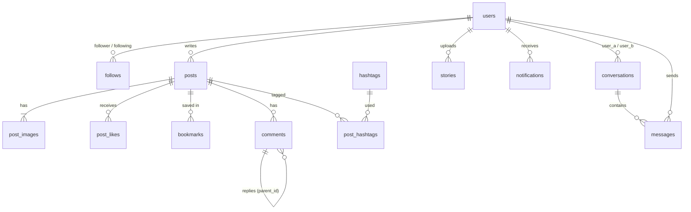

# 백엔드 개발 명세서 (backend.md)

> **기준**: 현재 프론트엔드(`frontend/src`) 화면에 존재하는 기능만 구현합니다.
> 화면에서 호출하지 않는 API, 화면에 표시·사용되지 않는 DB 컬럼은 만들지 않습니다.
> **DB**: 개발·운영(프로덕트) 환경 모두 **SQLite** 단일 파일을 사용합니다.
>
> 이 명세에 맞춰 코드에서 정리한 내역은 [13. 정리 이력](#13-정리-이력)에 있습니다.

---

## 1. 개요

| 항목 | 내용 |
| :--- | :--- |
| 프레임워크 | FastAPI (Python 3.10+) + Uvicorn |
| ORM / DB | SQLAlchemy 2.0 + **SQLite 3** (개발·운영 공통, `backend/instagram.db`) |
| 인증 | JWT Bearer 토큰 (`HS256`, PyJWT) + bcrypt 비밀번호 해시 |
| 이미지 처리 | Pillow (이미지 검증 · EXIF 회전 보정 · 리사이즈 · JPEG 재인코딩) |
| 파일 저장 | 로컬 디스크 `backend/static/uploads/{profiles,posts,stories}/`, `/static` 경로로 제공 |
| 실시간 갱신 | WebSocket 없음. 프론트엔드가 **폴링** (알림·DM 배지 30초, 대화 목록 5초, 대화창 3초) |
| API 문서 | Swagger `/docs`, ReDoc `/redoc`. `DOCS_ENABLED=false`면 비활성화 (운영 권장). Swagger **Authorize**에는 `/auth/login` 응답의 `access_token`을 붙여넣음 |
| 테스트 | pytest + FastAPI TestClient (임시 SQLite 파일 사용) |

### 의존성 (`requirements.txt`)
`fastapi`, `uvicorn[standard]`, `sqlalchemy>=2.0`, `pydantic[email]>=2`, `pydantic-settings`, `PyJWT`, `bcrypt`, `python-multipart`, `pillow`, 테스트용 `pytest`, `httpx`

---

## 2. 기능 범위

### 2.1 구현하는 기능 (화면 기준)

| 화면 / 컴포넌트 | 기능 |
| :--- | :--- |
| 로그인 · 회원가입 | 아이디 또는 이메일로 로그인, 이메일·성명·사용자 이름·비밀번호로 가입 (가입 즉시 로그인) |
| 홈 (`/`) | 피드 무한 스크롤, 스토리 바, 추천 계정. **게스트도 열람 가능** (공개 계정 최신 게시물) |
| 탐색 (`/explore`) | 인기 게시물 그리드, 모바일 검색 |
| 해시태그 (`/explore/tags/:tag`) | 해시태그 게시물 그리드 |
| 게시물 상세 (`/p/:id`, 모달) | 이미지 캐러셀, 좋아요(토글·좋아요한 사람 목록), 저장, 댓글·답글 작성/삭제, 본인 게시물 수정/삭제 |
| 만들기 모달 | 이미지 1~10장 + 캡션 + 위치로 게시물 작성 |
| 프로필 (`/:username`) | 프로필 정보·통계, 게시물 그리드, 저장됨 탭(본인), 팔로워/팔로잉 목록(내 팔로워 삭제), 팔로우 토글, 메시지 보내기 |
| 설정 (`/accounts/edit`) | 프로필 편집(사진·이름·사용자 이름·웹사이트·소개·비공개 전환), 비밀번호 변경 |
| 알림 (드로어 · `/notifications`) | 알림 목록, 읽음 처리, 안 읽은 수 배지, 팔로우 요청 수락/거절, 맞팔로우 |
| 검색 드로어 | 사용자 + 해시태그 통합 검색 (최근 검색어는 브라우저 `localStorage`, 서버 저장 없음) |
| 스토리 | 스토리 올리기/삭제, 24시간 후 만료 (본 스토리 표시는 `localStorage`, 서버 저장 없음) |
| 메시지 (`/direct`) | 1:1 대화 목록, 대화 시작, 메시지 전송/전송 취소, 읽음 표시, 안 읽은 대화 수 배지 |

### 2.2 구현하지 않는 기능 (화면에 없음)
소셜 로그인(페이스북 등), 앱 다운로드 안내, 이메일 변경, 계정 비활성화/삭제, 차단, 알림·메시지 설정, 그룹 채팅, 메시지 사진 전송, 메시지 요청함, 릴스·동영상, 좋아요/댓글 활동 모아보기, 보관함, 다국어·다크 모드.

---

## 3. 디렉터리 구조

```text
backend/
├── app/
│   ├── main.py                 # 앱 생성, CORS, 라우터·/static 마운트, 시작 시 테이블 생성 + 만료 스토리 정리
│   ├── core/
│   │   ├── config.py           # pydantic-settings(.env). 상대 경로는 backend/ 기준으로 해석
│   │   ├── database.py         # 엔진, SQLite PRAGMA, SessionLocal, get_db
│   │   ├── migrations.py       # 기존 DB 파일용 스키마 보정 (시작 시 자동, 여러 번 실행해도 안전)
│   │   └── security.py         # bcrypt 해시/검증, JWT 발급/검증
│   ├── models/                 # user.py · post.py · social.py · direct.py
│   ├── schemas/                # common.py · user.py · post.py · social.py · direct.py
│   ├── services/
│   │   ├── files.py            # 이미지 저장/삭제
│   │   └── social.py           # 가시성 규칙, 해시태그 동기화, 알림 생성, 게시물 직렬화
│   └── api/
│       ├── deps.py             # DB 세션, CurrentUser(필수 인증), OptionalUser(선택 인증)
│       └── v1/                 # router.py, auth.py, users.py, posts.py, stories.py,
│                               # notifications.py, search.py, direct.py
├── tests/                      # conftest.py(임시 DB), test_api.py, test_direct.py, test_schema.py
├── static/uploads/             # 업로드 이미지 (Git 제외)
├── seed.py                     # 데모 데이터 + 테스트 계정 + 샘플 대화 (python seed.py [--reset])
├── requirements.txt
├── .env.example
└── .env                        # Git 제외
```

---

## 4. 공통 규약

- **Base URL**: `/api/v1`
- **인증 헤더**: `Authorization: Bearer <access_token>`
  - **선택 인증 (게스트 허용)**: 읽기 전용 엔드포인트. 토큰이 없거나 무효면 게스트로 처리하고, 비공개 계정 콘텐츠는 숨기며 `is_liked`/`is_bookmarked`는 `false`.
  - **필수 인증**: 그 외 모든 엔드포인트. 토큰이 없거나 무효면 `401` → 프론트엔드가 토큰을 지우고 `/login`으로 이동.
- **에러 형식**: `{"detail": "한국어 메시지"}` (요청 검증 오류는 FastAPI 기본 `422` 배열)
- **상태 코드**: `400` 잘못된 요청(이미지 아님 등) · `401` 인증 실패 · `403` 권한 없음 · `404` 없음 또는 볼 수 없음 · `409` 사용자 이름/이메일 중복 · `413` 파일 10MB 초과
- **페이지네이션**: `?skip=0&limit=N` (offset 방식). 서버가 `limit` 상한을 강제 (게시물 50, 프로필 그리드 60)
- **시간**: DB에는 naive UTC로 저장, 응답은 ISO-8601 UTC 문자열 (`2026-11-12T03:21:00Z`)

---

## 5. 공통 응답 모델

응답에는 **프론트엔드가 실제로 읽는 필드만** 담습니다. 필드를 추가하려면 그 필드를 쓰는 화면이 있어야 합니다
(`tests/test_contract.py`가 응답 필드 목록을 고정해 검사).

```text
UserPublic   = { id, username, full_name, profile_image_url|null, is_private }
UserMe       = UserPublic + { bio, website }                       ← 설정 화면이 편집하는 값
UserListItem = UserPublic + { follow_status: "none"|"pending"|"accepted", is_me }
Profile      = UserPublic + { bio, website, post_count, follower_count, following_count,
                              follow_status, follows_you, is_me, can_view_posts }
Token        = { access_token, token_type: "bearer", user: UserMe }

PostOut      = { id, author: UserPublic, caption, location,
                 images: [{ id, image_url }],                      ← display_order 순으로 정렬해 반환
                 like_count, comment_count, is_liked, is_bookmarked, created_at }
CommentOut   = { id, parent_id|null, author: UserPublic, content, created_at }
HashtagOut   = { name, post_count }

StoryOut     = { id, image_url, created_at }
StoryGroup   = { user: UserPublic, stories: StoryOut[] }
NotificationOut = { id, type, actor: UserListItem, post_id|null, post_thumbnail|null,
                    comment_text|null, is_read, created_at }

MessageOut      = { id, content, created_at, is_mine }
ConversationOut = { id, other_user: UserPublic, last_message: MessageOut|null,
                    unread_count, other_last_read_id }
```

| 응답 필드 | DB 출처 |
| :--- | :--- |
| `post_count`, `follower_count`, `following_count` | `posts`, `follows(status='accepted')` 집계 |
| `like_count`, `comment_count`, `is_liked`, `is_bookmarked` | `post_likes`, `comments`, `bookmarks` 집계·존재 여부 |
| `follow_status`, `follows_you`, `can_view_posts` | `follows` 조회 + 8.1 가시성 규칙 |
| `HashtagOut.post_count` | `post_hashtags` 집계 |
| `post_thumbnail`, `comment_text` | `post_images(display_order=0)`, `comments.content` |
| `is_mine` | `messages.sender_id = 나` |
| `unread_count`, `other_last_read_id` | `messages` 집계, `conversations.*_last_read_id` |

---

## 6. REST API 명세

총 **45개** 엔드포인트 (+ 헬스 체크 `GET /api/health`). 프론트엔드 `src/api/*.js`의 메서드 45개와 1:1로 대응하며,
화면에서 호출하지 않는 엔드포인트는 없습니다. 테이블별 읽기/쓰기는 [6.8](#68-엔드포인트--테이블-매핑)을 참고하세요.

표의 **인증** 열: `선택` = 게스트 허용, `필수` = 로그인 필요.
**사용 화면** 열은 해당 API를 호출하는 프론트엔드 위치입니다.

### 6.1 Auth (`/api/v1/auth`)
| 메서드 | 경로 | 인증 | 요청 → 응답 | 사용 화면 / 규칙 |
| :--- | :--- | :--- | :--- | :--- |
| POST | `/register` | — | `{email, full_name, username, password(≥8)}` → `201 Token` | 회원가입. 사용자 이름/이메일 중복 `409` |
| POST | `/login` | — | `{username, password}` → `Token` | 로그인. `username` 자리에 이메일 허용. 실패 `401 "아이디 또는 비밀번호가 일치하지 않습니다."` |
| GET | `/me` | 필수 | → `UserMe` | 앱 시작 시 저장된 토큰으로 세션 복원 |

### 6.2 Users (`/api/v1/users`)
| 메서드 | 경로 | 인증 | 요청 → 응답 | 사용 화면 / 규칙 |
| :--- | :--- | :--- | :--- | :--- |
| GET | `/suggestions?limit=5` | 선택 | → `UserListItem[]` | 홈 추천, 새 메시지 모달. 아직 팔로우하지 않은 계정을 팔로워 수 순으로. 게스트는 인기 계정 |
| PUT | `/me/profile` | 필수 | `{full_name?, username?, bio?(≤150), website?, is_private?}` → `UserMe` | 설정 › 프로필 편집. 웹사이트에 스킴이 없으면 `https://` 보정. 공개로 전환 시 대기 중 요청 모두 자동 수락 |
| PUT | `/me/password` | 필수 | `{current_password, new_password(≥8)}` → `204` | 설정 › 비밀번호 변경. 현재 비밀번호 불일치 `400` |
| POST | `/me/avatar` | 필수 | multipart `file` → `UserMe` | 프로필 사진 변경 (기존 파일 삭제) |
| DELETE | `/me/avatar` | 필수 | → `UserMe` | 프로필 사진 삭제 (기본 아바타) |
| GET | `/me/saved?skip&limit` | 필수 | → `PostOut[]` | 프로필 › 저장됨 탭. 저장한 시각 최신순 |
| POST | `/me/follow-requests/{username}/accept` | 필수 | → `204` | 알림의 팔로우 요청 "확인". 해당 알림 타입을 `follow`로 변경 |
| DELETE | `/me/follow-requests/{username}` | 필수 | → `204` | 알림의 팔로우 요청 "삭제". 해당 알림 삭제 |
| DELETE | `/me/followers/{username}` | 필수 | → `204` | 내 팔로워 목록 모달의 "삭제" |
| GET | `/{username}` | 선택 | → `Profile` | 프로필 헤더 |
| GET | `/{username}/posts?skip&limit` | 선택 | → `PostOut[]` | 프로필 게시물 그리드. 비공개·미승인이면 `403` |
| POST | `/{username}/follow` | 필수 | → `{follow_status, follower_count}` | 팔로우 버튼 **토글**: 팔로우(비공개 계정이면 요청) ↔ 언팔로우/요청 취소 |
| GET | `/{username}/followers` · `/{username}/following` | 선택 | → `UserListItem[]` | 팔로워/팔로잉 모달. 비공개·미승인이면 `403` |

### 6.3 Posts (`/api/v1/posts`)
| 메서드 | 경로 | 인증 | 요청 → 응답 | 사용 화면 / 규칙 |
| :--- | :--- | :--- | :--- | :--- |
| GET | `/feed?skip&limit=10` | 선택 | → `PostOut[]` | 홈. 로그인: 내 게시물 + accepted 팔로잉 게시물 최신순 / 게스트: 공개 계정 전체 최신순 |
| GET | `/explore?skip&limit=24` | 선택 | → `PostOut[]` | 탐색. 볼 수 있는 타인 게시물, 좋아요 많은 순 → 최신순 |
| GET | `/tags/{name}?skip&limit` | 선택 | → `PostOut[]` | 해시태그 페이지. 최신순 |
| POST | `` (`/api/v1/posts`) | 필수 | multipart `files`(1~10장), `caption`(≤2200), `location`(≤100) → `201 PostOut` | 만들기 모달 (업로드 진행률 표시) |
| GET | `/{post_id}` | 선택 | → `PostOut` | 게시물 상세. 볼 수 없으면 `404` |
| PUT | `/{post_id}` | 필수 | `{caption?, location?}` → `PostOut` | 게시물 옵션 › 수정. 본인만(`403`). 해시태그 재동기화 |
| DELETE | `/{post_id}` | 필수 | → `204` | 게시물 옵션 › 삭제. 본인만. 이미지 파일도 삭제 |
| POST | `/{post_id}/like` | 필수 | → `{liked, like_count}` | 하트 버튼·더블탭 **토글** |
| GET | `/{post_id}/likes` | 선택 | → `UserListItem[]` | "좋아요 N개" 모달. 최근 좋아요 순 |
| POST | `/{post_id}/bookmark` | 필수 | → `{bookmarked}` | 저장 버튼 **토글** |
| GET | `/{post_id}/comments` | 선택 | → `CommentOut[]` | 상세 댓글. 오래된 순 평면 목록, 프론트가 `parent_id`로 트리 구성 |
| POST | `/{post_id}/comments` | 필수 | `{content(1~2200), parent_id?}` → `201 CommentOut` | 댓글·답글 작성 |
| DELETE | `/comments/{comment_id}` | 필수 | → `204` | 댓글 작성자 또는 게시물 작성자만. 답글 함께 삭제 |

### 6.4 Stories (`/api/v1/stories`)
| 메서드 | 경로 | 인증 | 요청 → 응답 | 사용 화면 / 규칙 |
| :--- | :--- | :--- | :--- | :--- |
| GET | `/feed` | 선택 | → `StoryGroup[]` | 스토리 바. 로그인: 나 + accepted 팔로잉 / 게스트: 공개 계정. 미만료만, 사용자별 그룹(내 것이 먼저, 이후 최근 업로드 순) |
| POST | `` | 필수 | multipart `file` → `201 StoryOut` | "내 스토리" 추가. 24시간 후 만료 |
| DELETE | `/{story_id}` | 필수 | → `204` | 스토리 뷰어에서 삭제. 본인만 |

### 6.5 Notifications (`/api/v1/notifications`) — 모두 필수 인증
| 메서드 | 경로 | 요청 → 응답 | 사용 화면 / 규칙 |
| :--- | :--- | :--- | :--- |
| GET | `` | → `NotificationOut[]` (최근 50개 고정, 쿼리 파라미터 없음) | 알림 드로어·페이지 |
| GET | `/unread-count` | → `{count}` | 사이드바 하트 배지 (30초 폴링) |
| POST | `/read-all` | → `204` | 알림 목록을 열면 모두 읽음 처리 |

### 6.6 Search (`/api/v1/search`)
| 메서드 | 경로 | 인증 | 요청 → 응답 | 사용 화면 / 규칙 |
| :--- | :--- | :--- | :--- | :--- |
| GET | `?q=` (1~50자) | 선택 | → `{users: UserPublic[≤15], hashtags: HashtagOut[≤10]}` | 검색 드로어, 모바일 탐색 검색, 새 메시지 모달. `#`으로 시작하면 해시태그만. 사용자는 사용자 이름·성명 부분 일치, 해시태그는 접두어 일치 |

### 6.7 Direct Messages (`/api/v1/direct`) — 모두 필수 인증
| 메서드 | 경로 | 요청 → 응답 | 사용 화면 / 규칙 |
| :--- | :--- | :--- | :--- |
| GET | `/conversations` | → `ConversationOut[]` (≤100) | 대화 목록 (5초 폴링). 메시지가 1개 이상인 대화만, 최근 메시지 순 |
| POST | `/conversations` | `{username}` → `ConversationOut` | 프로필 "메시지 보내기", 새 메시지 모달. 같은 두 사람이면 기존 대화 반환. 자기 자신 `400` |
| GET | `/conversations/{id}` | → `ConversationOut` | 대화창 헤더·읽음 표시 (3초 폴링). 참여자가 아니면 `404` |
| GET | `/conversations/{id}/messages?after_id&before_id&limit=50` | → `MessageOut[]` (오래된 순) | `after_id`: 새 메시지 폴링 / `before_id`: 위로 스크롤 시 이전 메시지 |
| POST | `/conversations/{id}/messages` | `{content(1~1000, 앞뒤 공백 제거)}` → `201 MessageOut` | 메시지 전송 |
| POST | `/conversations/{id}/read` | → `204` | 대화창을 열거나 새 메시지를 받으면 읽음 처리 |
| DELETE | `/messages/{message_id}` | → `204` | 전송 취소. 본인 메시지만(`404`) |
| GET | `/unread-count` | → `{count}` | 사이드바 메시지 배지 = 안 읽은 메시지가 있는 **대화 수** (30초 폴링) |

### 6.8 엔드포인트 ↔ 테이블 매핑
**R** = 읽기, **W** = 쓰기(추가·수정·삭제). 경로는 `/api/v1` 생략. 모든 엔드포인트는 7장의 테이블·컬럼만 사용합니다.

| 엔드포인트 | users | follows | posts | post_images | post_likes | bookmarks | comments | hashtags · post_hashtags | stories | notifications | conversations | messages |
| :--- | :-: | :-: | :-: | :-: | :-: | :-: | :-: | :-: | :-: | :-: | :-: | :-: |
| `POST /auth/register` | W | | | | | | | | | | | |
| `POST /auth/login`, `GET /auth/me` | R | | | | | | | | | | | |
| `GET /users/suggestions` | R | R | | | | | | | | | | |
| `PUT /users/me/profile` | W | W¹ | | | | | | | | W¹ | | |
| `PUT /users/me/password`, `POST·DELETE /users/me/avatar` | W | | | | | | | | | | | |
| `GET /users/me/saved` | R | R | R | R | R | R | R | | | | | |
| `POST /users/me/follow-requests/{u}/accept` · `DELETE …/{u}` | R | W | | | | | | | | W | | |
| `DELETE /users/me/followers/{u}` | R | W | | | | | | | | | | |
| `GET /users/{u}` | R | R | R | | | | | | | | | |
| `GET /users/{u}/posts` | R | R | R | R | R | R | R | | | | | |
| `POST /users/{u}/follow` | R | W | | | | | | | | W | | |
| `GET /users/{u}/followers` · `/following` | R | R | | | | | | | | | | |
| `GET /posts/feed` · `/explore` · `/tags/{name}` · `/{id}` | R | R | R | R | R | R | R | R² | | | | |
| `POST /posts` | | | W | W | | | | W | | | | |
| `PUT /posts/{id}` | | | W | | | | | W | | | | |
| `DELETE /posts/{id}` | | | W | W³ | W³ | W³ | W³ | W³ | | W³ | | |
| `POST /posts/{id}/like` | | R | R | | W | | | | | W | | |
| `GET /posts/{id}/likes` | R | R | R | | R | | | | | | | |
| `POST /posts/{id}/bookmark` | | R | R | | | W | | | | | | |
| `GET /posts/{id}/comments` | R | R | R | | | | R | | | | | |
| `POST /posts/{id}/comments` | | R | R | | | | W | | | W | | |
| `DELETE /posts/comments/{id}` | | | R | | | | W | | | W³ | | |
| `GET /stories/feed` | R | R | | | | | | | R | | | |
| `POST /stories`, `DELETE /stories/{id}` | | | | | | | | | W | | | |
| `GET /notifications` | R | R | | R | | | R | | | R | | |
| `GET /notifications/unread-count` | | | | | | | | | | R | | |
| `POST /notifications/read-all` | | | | | | | | | | W | | |
| `GET /search` | R | | | | | | | R | | | | |
| `GET /direct/conversations` · `/{id}` | R | | | | | | | | | | R | R |
| `POST /direct/conversations` | R | | | | | | | | | | W | R |
| `GET /direct/conversations/{id}/messages` | | | | | | | | | | | R | R |
| `POST /direct/conversations/{id}/messages` | | | | | | | | | | | W | W |
| `POST /direct/conversations/{id}/read` | | | | | | | | | | | W | R |
| `DELETE /direct/messages/{id}` | | | | | | | | | | | W | W |
| `GET /direct/unread-count` | | | | | | | | | | | R | R |

로그인이 필요한(또는 토큰을 보낸) 요청은 모두 토큰 확인을 위해 `users`를 추가로 읽습니다. 표에는 그 외의 접근만 표시했습니다.

¹ 비공개 → 공개 전환 시 `pending` 요청 수락, `follow_request` 알림을 `follow`로 변경
² `/tags/{name}`만 해시태그 조인
³ `ON DELETE CASCADE`로 연쇄 삭제

---

## 7. 데이터베이스 (SQLite)

### 7.1 공통 규칙
- 모델 위치 `backend/app/models/`. 서버 시작 시 `Base.metadata.create_all()`로 **없는 테이블만** 생성하고, 이어서 `app/core/migrations.py`가 기존 테이블을 보정합니다 (10.3 참고).
- 모든 `DATETIME`은 naive UTC. 불리언은 SQLite `INTEGER 0/1`.
- 외래키는 모두 `ON DELETE CASCADE` (사용자 삭제 시 관련 데이터 정리). `PRAGMA foreign_keys=ON` 필수.
- **13개 테이블**: 화면 기능에 필요한 컬럼만 둡니다.

### 7.2 ERD



### 7.3 테이블

**`users`** — 계정·프로필
| 컬럼 | 타입 | 제약 | 사용처 |
| :--- | :--- | :--- | :--- |
| `id` | INTEGER | PK | |
| `username` | VARCHAR(30) | UNIQUE, NOT NULL | `^[a-z0-9._]{1,30}$`, 소문자 저장 |
| `email` | VARCHAR(255) | UNIQUE, NOT NULL | 로그인, 소문자 저장 |
| `hashed_password` | VARCHAR(255) | NOT NULL | bcrypt |
| `full_name` | VARCHAR(50) | NOT NULL, 기본 `''` | 성명 |
| `bio` | TEXT | NOT NULL, 기본 `''` | 소개 (≤150자, 줄바꿈 허용) |
| `website` | VARCHAR(255) | NOT NULL, 기본 `''` | 프로필 링크 |
| `profile_image_url` | VARCHAR(500) | NULL | `NULL` = 기본 아바타 |
| `is_private` | BOOLEAN | NOT NULL, 기본 0 | 비공개 계정 |
| `created_at` | DATETIME | NOT NULL | 추천 계정 정렬 보조 |

**`follows`** — 팔로우 관계
| 컬럼 | 타입 | 제약 |
| :--- | :--- | :--- |
| `follower_id` | INTEGER | PK, FK→users |
| `following_id` | INTEGER | PK, FK→users |
| `status` | VARCHAR(10) | CHECK IN (`accepted`, `pending`) |
| `created_at` | DATETIME | 팔로워/팔로잉 목록 정렬 |
- CHECK `follower_id <> following_id` · INDEX `(following_id, status)`

**`posts`** — 게시물
| 컬럼 | 타입 | 제약 |
| :--- | :--- | :--- |
| `id` | INTEGER | PK |
| `user_id` | INTEGER | FK→users, INDEX |
| `caption` | TEXT | NOT NULL, 기본 `''` (≤2200) |
| `location` | VARCHAR(100) | NOT NULL, 기본 `''` |
| `created_at` | DATETIME | INDEX (피드 정렬) |

**`post_images`** — 게시물 이미지 (1~10장)
`id` PK · `post_id` FK→posts, INDEX · `image_url` VARCHAR(500) · `display_order` INTEGER (0부터, 캐러셀 순서)

**`post_likes`** — 좋아요
`(user_id, post_id)` 복합 PK · `post_id` INDEX · `created_at` (좋아요한 사람 목록 정렬)

**`bookmarks`** — 저장
`(user_id, post_id)` 복합 PK · `post_id` INDEX · `created_at` (저장됨 탭 정렬)

**`comments`** — 댓글 / 답글
| 컬럼 | 타입 | 제약 |
| :--- | :--- | :--- |
| `id` | INTEGER | PK |
| `post_id` | INTEGER | FK→posts, INDEX |
| `user_id` | INTEGER | FK→users |
| `parent_id` | INTEGER | FK→comments, NULL, INDEX (`NULL` = 최상위) |
| `content` | TEXT | NOT NULL |
| `created_at` | DATETIME | |

**`hashtags`** — 해시태그 사전
`id` PK · `name` VARCHAR(100) UNIQUE (소문자, `#` 제외)

**`post_hashtags`** — 게시물 ↔ 해시태그
`(post_id, hashtag_id)` 복합 PK · `hashtag_id` INDEX

**`stories`** — 24시간 스토리
`id` PK · `user_id` FK→users · `image_url` VARCHAR(500) · `created_at` · `expires_at` (INDEX)
- INDEX `(user_id, expires_at)`

**`notifications`** — 알림
| 컬럼 | 타입 | 제약 |
| :--- | :--- | :--- |
| `id` | INTEGER | PK |
| `user_id` | INTEGER | FK→users (수신자) |
| `actor_id` | INTEGER | FK→users (행동한 사람) |
| `type` | VARCHAR(20) | CHECK IN (`like`,`comment`,`reply`,`follow`,`follow_request`) |
| `post_id` | INTEGER | FK→posts, NULL |
| `comment_id` | INTEGER | FK→comments, NULL |
| `is_read` | BOOLEAN | NOT NULL, 기본 0 |
| `created_at` | DATETIME | INDEX |
- INDEX `(user_id, is_read)` — 안 읽은 수 폴링

**`conversations`** — 1:1 대화방
| 컬럼 | 타입 | 제약 |
| :--- | :--- | :--- |
| `id` | INTEGER | PK |
| `user_a_id` | INTEGER | FK→users (두 사용자 중 작은 id) |
| `user_b_id` | INTEGER | FK→users, INDEX (큰 id) |
| `a_last_read_id` / `b_last_read_id` | INTEGER | NOT NULL, 기본 0 — 각자 읽은 마지막 메시지 id |
| `created_at` | DATETIME | NOT NULL |
| `last_message_at` | DATETIME | NULL, INDEX — 목록 정렬, `NULL`이면 목록에서 숨김 |
- CHECK `user_a_id < user_b_id` · UNIQUE `(user_a_id, user_b_id)` — 두 사람 사이 대화방은 1개

**`messages`** — 메시지
`id` PK · `conversation_id` FK→conversations · `sender_id` FK→users · `content` TEXT NOT NULL · `created_at`
- INDEX `(conversation_id, id)` — 대화창 페이지네이션·폴링

---

## 8. 비즈니스 규칙

### 8.1 가시성
게시물·댓글·좋아요 목록·팔로워/팔로잉 목록은 다음 중 하나일 때만 볼 수 있습니다. 볼 수 없는 게시물은 `404`, 목록은 `403`.
1. 본인 소유
2. 작성자가 공개 계정
3. 작성자를 `accepted` 상태로 팔로우 중

게스트는 2번만 해당합니다.

### 8.2 팔로우
- 공개 계정 팔로우 → 즉시 `accepted` + `follow` 알림
- 비공개 계정 팔로우 → `pending` + `follow_request` 알림. 수락 시 `accepted`, 알림 타입 `follow`로 변경. 거절 시 관계·알림 삭제
- 언팔로우·요청 취소 → 관계와 관련 알림 삭제
- 비공개 → 공개 전환 시 `pending` 요청 모두 수락

### 8.3 알림
| 타입 | 발생 시점 | 취소 시 |
| :--- | :--- | :--- |
| `like` | 게시물 좋아요 | 좋아요 취소하면 삭제 |
| `comment` | 게시물에 댓글 | 댓글 삭제 시 CASCADE |
| `reply` | 내 댓글에 답글 | 답글 삭제 시 CASCADE |
| `follow` / `follow_request` | 8.2 참고 | 8.2 참고 |
- 자기 자신에 대한 행동은 알림을 만들지 않습니다.

### 8.4 댓글
- 답글은 **1단계 깊이**만 허용: 답글에 다시 답글을 달면 최상위 댓글의 `parent_id`로 저장
- 부모 댓글 삭제 시 답글도 삭제

### 8.5 해시태그
- 캡션에서 정규식 `#([0-9A-Za-z_가-힣]+)`로 추출, 소문자로 저장
- 100자를 넘는 해시태그는 저장하지 않음 (`hashtags.name` VARCHAR(100). SQLite는 길이를 강제하지 않으므로 앱에서 검사)
- 게시물 작성·수정 시 `post_hashtags`를 다시 맞춤

### 8.6 스토리
- 업로드 후 24시간 뒤 만료. 만료된 스토리는 조회에서 제외
- 만료 스토리의 DB 행·이미지 파일 정리: 서버 시작 시 + `STORY_PURGE_INTERVAL_MINUTES`(기본 60분)마다 백그라운드 작업으로

### 8.7 메시지
- 두 사용자 쌍은 `(작은 id, 큰 id)`로 정렬해 저장 → 대화방 중복 방지
- 읽음 처리 = 내 `*_last_read_id`를 대화의 최신 메시지 id로 올림 (내려가지 않음). 내가 보낸 메시지는 보내는 즉시 나에게 읽음
- 안 읽은 메시지 수 = 상대가 보냈고 id가 내 `last_read_id`보다 큰 메시지 수
- 대화창의 "읽음/전송됨" = 상대의 `last_read_id ≥ 내 마지막 메시지 id` 여부
- 전송 취소 시 메시지 행 삭제 후 `last_message_at`을 남은 최신 메시지 시각으로 갱신

---

## 9. 파일 저장소

DB에는 이미지 URL만 저장하고, 파일은 로컬 디스크에 둡니다.

| 폴더 | 용도 | 처리 |
| :--- | :--- | :--- |
| `static/uploads/profiles/` | 프로필 사진 | 320×320 정방형 크롭 |
| `static/uploads/posts/` | 게시물 이미지 | 긴 변 최대 1440px |
| `static/uploads/stories/` | 스토리 | 긴 변 최대 1920px |

- 업로드는 Pillow로 실제 이미지인지 검증(`400`), 10MB 초과 `413`, 모두 **JPEG로 재인코딩**(EXIF 메타데이터 제거)
- 파일명 `uuid4().hex + ".jpg"`. 아바타 교체·게시물 삭제·스토리 삭제·만료 시 파일도 삭제
- 파일 삭제는 업로드 폴더 내부 경로만 허용 (경로 탈출 방지)

---

## 10. SQLite 운영 기준 (개발 · 프로덕트 공통)

### 10.1 연결 설정 (`app/core/database.py`, 매 연결마다 실행)
| PRAGMA | 값 | 이유 |
| :--- | :--- | :--- |
| `foreign_keys` | `ON` | 외래키·CASCADE 동작 (SQLite 기본값은 OFF) |
| `journal_mode` | `WAL` | 읽기와 쓰기가 서로 막지 않음 |
| `busy_timeout` | `5000` | 다른 쓰기가 끝날 때까지 최대 5초 대기 (즉시 `database is locked` 오류 방지) |
| `synchronous` | `NORMAL` | WAL과 함께 쓰면 안전하면서 쓰기 속도 향상 |

- 엔진 옵션 `connect_args={"check_same_thread": False}` (FastAPI 스레드풀에서 세션 사용)
- `instagram.db`와 함께 생기는 `instagram.db-wal`, `instagram.db-shm`은 **지우지 않습니다**

### 10.2 환경별 설정 (`.env`)
| 변수 | 개발 | 프로덕트 |
| :--- | :--- | :--- |
| `ENVIRONMENT` | `development` | `production` (안전한 `SECRET_KEY`가 없으면 서버 시작 거부) |
| `DATABASE_URL` | `sqlite:///./instagram.db` | `sqlite:////영구/디스크/경로/instagram.db` (절대 경로, 재배포 시 지워지지 않는 위치) |
| `UPLOAD_DIR` | `./static/uploads` | 영구 디스크의 업로드 폴더 |
| `SECRET_KEY` | `run.ps1`이 자동 생성 | **필수**. 32자 이상 랜덤 값. 코드 기본값·`.env.example` 값이면 시작 거부 |
| `ACCESS_TOKEN_EXPIRE_MINUTES` | `1440` | `1440` |
| `CORS_ORIGINS` | `["http://localhost:5173"]` | 실제 프론트엔드 도메인만 |
| `DOCS_ENABLED` | `true` | `false` (Swagger 비공개) |
| `STORY_PURGE_INTERVAL_MINUTES` | `60` | `60` |

### 10.3 프로덕트 배포 기준
- **서버 1대**에서 실행합니다. SQLite 파일은 여러 서버가 네트워크 디스크로 공유하면 안 됩니다.
- Uvicorn 워커는 1~2개 권장. 쓰기는 한 번에 하나씩 처리되므로 워커를 늘려도 쓰기 성능은 늘지 않습니다.
- 프론트엔드 빌드(`frontend/dist`)와 `/static/uploads`는 Nginx 같은 웹 서버가 직접 제공하고, `/api`만 Uvicorn으로 프록시하는 구성을 권장합니다.
- **백업**: 서버 실행 중에도 안전한 방식으로 매일 백업합니다. DB 파일을 그냥 복사하면 WAL 내용이 빠질 수 있습니다.
  ```bash
  sqlite3 instagram.db ".backup 'backup/instagram-YYYYMMDD.db'"
  ```
  업로드 폴더(`static/uploads`)도 함께 백업합니다.
- **스키마 변경**: `create_all()`은 기존 테이블의 컬럼을 추가·변경하지 않습니다.
  - 기존 테이블 변경은 `app/core/migrations.py`에 **현재 스키마를 확인한 뒤 바꾸는** 단계로 추가합니다. 서버 시작 시와 `seed.py` 실행 시 자동으로 실행되며, 이미 적용된 단계는 건너뜁니다.
  - 프로덕트는 배포 전에 반드시 DB를 백업합니다. 변경이 잦아지면 Alembic 도입을 검토합니다.
  - 마이그레이션 중에는 DB에 쓰기 잠금이 필요하므로, 같은 DB를 쓰는 다른 프로세스(이전 서버, 쓰기 모드로 연 DB Browser 등)를 먼저 종료합니다. 잠금을 얻지 못하면 서버가 시작되지 않습니다.

---

## 11. 보안
- 비밀번호는 bcrypt 해시로만 저장, 평문 저장·로그 금지
- JWT: `sub=user_id`, `exp` 기본 24시간. 서명 키는 `SECRET_KEY`
- 업로드 검증·재인코딩 (9장)
- 권한 검사: 게시물 수정·삭제는 작성자만, 댓글 삭제는 댓글 작성자 또는 게시물 작성자, 스토리 삭제는 본인, 메시지 조회·전송은 대화 참여자만, 전송 취소는 보낸 사람만
- CORS 화이트리스트 (`CORS_ORIGINS`)
- 프로덕트는 HTTPS 뒤에서 운영 (토큰이 평문으로 오가지 않도록)

---

## 12. 테스트

```powershell
cd backend
.\venv\Scripts\python.exe -m pytest -q
```

임시 SQLite 파일과 임시 업로드 폴더를 사용합니다. 검증 범위:
- 인증: 가입·중복(409)·잘못된 사용자 이름(422)·아이디/이메일 로그인·토큰 검증
- 프로필: 수정·아바타 업로드/삭제·비밀번호 변경
- 게시물: 다중 이미지 작성·피드·탐색·좋아요·저장·댓글/답글·알림·해시태그·검색·수정·삭제 권한
- 비공개 계정: 팔로우 요청·수락·가시성
- 스토리: 업로드·피드·삭제
- 메시지: 대화 시작·중복 방지·전송·외부인 차단·안 읽은 수·읽음 표시·이전 메시지·전송 취소
- 스키마: 예전 DB의 불필요한 컬럼 삭제 마이그레이션(재실행 안전), 잠긴 DB 안내, 삭제한 API가 없는지, 토큰 없음·잘못된 토큰 `401`
- 계약: 주요 응답의 필드 목록이 5장과 정확히 같은지, 100자 초과 해시태그 미저장 (`test_contract.py`)

---

## 13. 정리 이력

이 명세에 맞춰 2026-11-14에 백엔드 코드를 정리했습니다.

### 13.1 삭제한 API (프론트엔드에서 호출하지 않음)
| API | 이유 |
| :--- | :--- |
| `GET /users/search` | 검색 화면은 모두 `GET /search`를 사용 |
| `GET /users/me/follow-requests` | 팔로우 요청은 알림 목록에서 수락/거절. 프론트 `userApi.followRequests`도 함께 삭제 |
| `POST /auth/token` | Swagger 전용 폼 로그인. 인증 방식을 `HTTPBearer`로 바꿔 Swagger Authorize에 토큰을 붙여넣도록 변경. 토큰이 없을 때는 계속 `401` |

### 13.2 삭제한 DB 컬럼 (화면에서 사용하지 않음)
| 컬럼 | 함께 바꾼 코드 |
| :--- | :--- |
| `users.is_active` | 로그인·인증·검색·추천·프로필 조회·DM의 `is_active` 조건 제거 |
| `users.updated_at` | — |
| `posts.updated_at` | `PostOut.updated_at` 제거, 프론트 `PostOptions.jsx`의 전달 제거 |
| `hashtags.created_at` | — |

기존 `instagram.db`는 서버 시작 시 `app/core/migrations.py`가 위 컬럼을 `ALTER TABLE ... DROP COLUMN`으로 삭제합니다 (데이터는 유지). 이 컬럼들은 DB 기본값 없는 `NOT NULL`이라, 그대로 두면 새 행을 넣을 때 오류가 납니다.

### 13.3 추가한 항목 (운영 SQLite 대비)
| 항목 | 내용 |
| :--- | :--- |
| PRAGMA | `busy_timeout=5000`, `synchronous=NORMAL` |
| 만료 스토리 정리 | 서버 시작 시 + `STORY_PURGE_INTERVAL_MINUTES`마다 백그라운드 작업 |
| `DOCS_ENABLED` | `false`면 `/docs`, `/redoc`, `/openapi.json` 비활성화 |
| `ENVIRONMENT` | `production`일 때 `SECRET_KEY`가 기본값·예시값이거나 32자 미만이면 시작 거부 |
| 테스트 | `tests/test_schema.py` (마이그레이션, 삭제한 API, 401) |

### 13.4 API 명세 검증 (2026-11-14)
프론트엔드 `src/api/*.js`의 메서드 45개, 각 화면이 읽는 응답 필드, 7장 스키마를 백엔드 엔드포인트 45개와 대조했습니다.

| 항목 | 결과 |
| :--- | :--- |
| 누락된 엔드포인트 | 없음. 공유(링크 복사)·본 스토리·최근 검색어는 브라우저에서만 처리 |
| 사용하지 않는 엔드포인트 | 없음. 45개 모두 화면에서 호출 |
| 응답에서 뺀 필드 (화면에서 읽지 않음) | `UserMe.email`·`created_at`, `images[].display_order`, `CommentOut.post_id`, `StoryOut.expires_at`, `MessageOut.conversation_id`·`sender_id`, `ConversationOut.last_message_at` (DB 컬럼은 정렬·필터에 쓰므로 유지) |
| 쿼리 파라미터 | `GET /notifications`의 `limit` 제거 (프론트가 보내지 않음, 50개 고정) · `GET /posts/explore` 기본 `limit` 30 → 24 (탐색 화면 값) |
| DB 정합성 | `hashtags.name` VARCHAR(100)을 넘는 해시태그가 저장될 수 있던 문제 → 앱에서 100자 초과 제외 |
| 문서 | 5장 응답 모델·필드 출처, 6.8 엔드포인트 ↔ 테이블 매핑 추가 |
