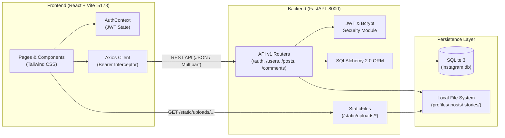

# 전체 프로젝트 개발 가이드 (guide.md)

## 1. 프로젝트 개요
본 문서는 **React + FastAPI + SQLite** 기술 스택을 기반으로 완전한 기능의 **Instagram 클론 웹 애플리케이션**을 구축하기 위한 통합 아키텍처 및 개발 가이드입니다.

### 1.1 문서 구성 및 참조 안내
| 문서 파일명 | 역할 및 주요 내용 |
| :--- | :--- |
| **[db.md](file:///c:/Users/user/OneDrive/문서/Instagram_clone/db.md)** | SQLite 데이터베이스 ERD, 10개 핵심 테이블 스키마, 인덱스 설계 및 SQLite 최적화 설정 |
| **[backend.md](file:///c:/Users/user/OneDrive/문서/Instagram_clone/backend.md)** | FastAPI 프로젝트 구조, JWT 인증, 프로필/아바타 관리, 게시물/피드 REST API 상세 명세 |
| **[front.md](file:///c:/Users/user/OneDrive/문서/Instagram_clone/front.md)** | React + Vite + Tailwind CSS 디렉터리 구조, 라우팅, 페이지/컴포넌트 UI/UX 및 상태 관리 명세 |
| **[guide.md](file:///c:/Users/user/OneDrive/문서/Instagram_clone/guide.md)** | 시스템 아키텍처, 개발 환경 구축, 실행 방법, 단계별 개발 로드맵 및 통합 테스트 가이드 |

---

## 2. 시스템 아키텍처



---

## 3. 전체 프로젝트 디렉터리 구조

```text
Instagram_clone/
├── db.md                       # 데이터베이스 설계 명세서
├── backend.md                  # 백엔드 개발 요청 명세서
├── front.md                    # 프론트엔드 개발 명세서
├── guide.md                    # 전체 프로젝트 가이드 (현재 문서)
├── backend/                    # FastAPI 백엔드 서버
│   ├── app/
│   ├── static/uploads/
│   ├── requirements.txt
│   └── .env
└── frontend/                   # React 프론트엔드 웹 앱
    ├── src/
    ├── public/
    ├── package.json
    └── vite.config.js
```

---

## 4. 개발 환경 요구사항 및 초기 설정 가이드

### 4.1 사전 준비물 (Prerequisites)
- **Python**: `3.10` 이상
- **Node.js**: `18.x` 또는 `20.x` LTS 이상 (`npm` 포함)
- **Git**: 버전 관리 도구

### 4.2 백엔드(FastAPI) 환경 세팅 및 실행

1. **가상환경 생성 및 활성화 (Windows PowerShell 기준)**
   ```powershell
   cd backend
   python -m venv venv
   .\venv\Scripts\Activate.ps1
   ```

2. **필수 패키지 설치 (`requirements.txt`)**
   ```text
   fastapi>=0.110.0
   uvicorn[standard]>=0.29.0
   sqlalchemy>=2.0.28
   alembic>=1.13.1
   pydantic[email]>=2.6.0
   pydantic-settings>=2.2.1
   python-jose[cryptography]>=3.3.0
   passlib[bcrypt]>=1.7.4
   bcrypt==4.0.1
   python-multipart>=0.0.9
   pillow>=10.2.0
   pytest>=8.0.0
   httpx>=0.27.0
   ```
   ```powershell
   pip install -r requirements.txt
   ```

3. **환경변수 파일(`backend/.env`) 작성**
   ```ini
   PROJECT_NAME="Instagram Clone API"
   DATABASE_URL="sqlite:///./instagram.db"
   SECRET_KEY="your-super-secret-jwt-key-change-in-production"
   ALGORITHM="HS256"
   ACCESS_TOKEN_EXPIRE_MINUTES=1440
   UPLOAD_DIR="./static/uploads"
   CORS_ORIGINS=["http://localhost:5173","http://127.0.0.1:5173"]
   ```

4. **백엔드 개발 서버 실행**
   ```powershell
   uvicorn app.main:app --reload --host 0.0.0.0 --port 8000
   ```
   - API 서버 주소: `http://localhost:8000`
   - Swagger UI 문서: `http://localhost:8000/docs`
   - ReDoc 문서: `http://localhost:8000/redoc`

---

### 4.3 프론트엔드(React) 환경 세팅 및 실행

1. **프로젝트 패키지 설치**
   ```powershell
   cd frontend
   npm install
   ```
   - 주요 의존성 패키지: `react-router-dom`, `axios`, `lucide-react`, `tailwindcss`, `postcss`, `autoprefixer`

2. **Vite 프록시 설정 (`frontend/vite.config.js`)**
   백엔드 API(`/api`)와 정적 업로드 이미지(`/static`)를 프론트엔드 개발 서버에서 상대 경로로 호출할 수 있도록 프록시를 구성합니다.
   ```javascript
   import { defineConfig } from 'vite'
   import react from '@vitejs/plugin-react'

   export default defineConfig({
     plugins: [react()],
     server: {
       port: 5173,
       proxy: {
         '/api': {
           target: 'http://localhost:8000',
           changeOrigin: true,
         },
         '/static': {
           target: 'http://localhost:8000',
           changeOrigin: true,
         },
       },
     },
   })
   ```

3. **프론트엔드 개발 서버 실행**
   ```powershell
   npm run dev
   ```
   - 웹 애플리케이션 접속 주소: `http://localhost:5173`

---

## 5. 단계별 개발 로드맵 (Milestones)

프로젝트는 우선순위에 따라 **4단계(Phase 1 ~ Phase 4)**로 나누어 점진적으로 구현하고 검증합니다.

### Phase 1: 기반 구축 + 회원가입/로그인(JWT) 및 프로필 관리 (최우선 핵심 목표)
- [ ] **DB & 백엔드 코어**: SQLite 연결(`PRAGMA foreign_keys=ON`), `users` 및 `follows` 테이블 생성, Bcrypt 해싱 및 JWT 발급 유틸리티 구현
- [ ] **인증 API**:
  - `POST /api/v1/auth/register` (이메일/아이디 중복 검증, 가입 즉시 토큰 발급)
  - `POST /api/v1/auth/login` (아이디 또는 이메일 로그인)
  - `GET /api/v1/auth/me` (내 정보 확인)
- [ ] **프로필 관리 API**:
  - `GET /api/v1/users/{username}` (프로필 정보 및 게시물/팔로워/팔로잉 카운트)
  - `PUT /api/v1/users/me/profile` (이름, 사용자 이름, 소개글 `bio`, 웹사이트 수정)
  - `POST /api/v1/users/me/avatar` & `DELETE /api/v1/users/me/avatar` (프로필 사진 업로드 및 기본 이미지 초기화)
  - `PUT /api/v1/users/me/password` (비밀번호 변경)
- [ ] **프론트엔드 인증 & 프로필 UI**:
  - `AuthContext` 및 `ProtectedRoute` 구성
  - 로그인(`/login`), 회원가입(`/register`) 페이지 구현
  - 프로필 페이지(`/:username`) 및 프로필 편집 페이지(`/accounts/edit`), 프로필 사진 업로드 모달 구현

### Phase 2: 게시물 CRUD 및 다중 이미지 피드 시스템
- [ ] `posts`, `post_images`, `hashtags`, `post_hashtags` 모델 및 API 구현
- [ ] 다중 이미지 업로드(`POST /api/v1/posts`) 및 캐러셀 컴포넌트(`ImageCarousel`) 구현
- [ ] 메인 홈 피드(`GET /api/v1/posts/feed`) 및 프로필 게시물 3열 그리드 연동

### Phase 3: 소셜 인터랙션 (좋아요, 댓글/대댓글, 팔로우, 북마크)
- [ ] `post_likes`, `bookmarks`, `comments` 테이블 및 토글 API 구현
- [ ] 더블 클릭 좋아요 애니메이션, 댓글/대댓글 작성 및 삭제, 게시물 상세 모달(`PostDetailModal`) 구현
- [ ] 사용자 팔로우/언팔로우(`POST /api/v1/users/{username}/follow`) 및 팔로워/팔로잉 목록 모달 연동

### Phase 4: 검색, 탐색 탭, 스토리 및 알림 (완성도 고도화)
- [ ] 사용자 및 해시태그 통합 검색 드로어(`SearchDrawer`) 및 탐색 페이지(`/explore`) 구현
- [ ] 24시간 스토리(`stories`) 및 실시간/폴링 알림(`notifications`) 기능 추가
- [ ] 스켈레톤 로딩 UI, 반응형 레이아웃(모바일 하단 탭바) 및 예외 처리 마감

---

## 6. 핵심 기능 통합 검증 시나리오 (Checklist)

개발 완료 후 아래 시나리오를 순서대로 테스트하여 정상 동작을 확인합니다.

1. **회원가입 및 중복 검증**:
   - `/register`에서 신규 계정 가입 시 정상적으로 JWT가 발급되고 메인 페이지(`/`)로 이동하는지 확인
   - 동일한 `username` 또는 `email`로 재가입 시도 시 `409 Conflict` 에러 메시지가 화면에 표시되는지 확인
2. **로그인 및 세션 유지**:
   - 로그아웃 후 `/login`에서 가입한 계정으로 로그인하고, 브라우저 새로고침(`F5`) 후에도 로그인 상태(`GET /api/v1/auth/me`)가 유지되는지 확인
3. **프로필 사진 업로드 및 삭제**:
   - 프로필 페이지 또는 `/accounts/edit`에서 새 프로필 사진을 업로드했을 때 즉시 헤더와 사이드바 아바타가 변경되는지 확인
   - `[현재 사진 삭제]` 클릭 시 기본 아바타 이미지로 복원되는지 확인
4. **프로필 소개글(Bio) 및 정보 수정**:
   - `/accounts/edit`에서 이름, 소개글(여러 줄 텍스트), 웹사이트 링크를 수정하고 저장한 뒤 `/:username` 프로필 페이지에 즉시 반영되는지 확인
5. **게시물 업로드 및 인터랙션**:
   - 새 게시물 모달에서 이미지 2장 이상과 캡션을 등록한 후, 피드 캐러셀 넘기기, 좋아요 토글, 댓글 작성, 북마크 저장이 모두 정상 작동하는지 확인
