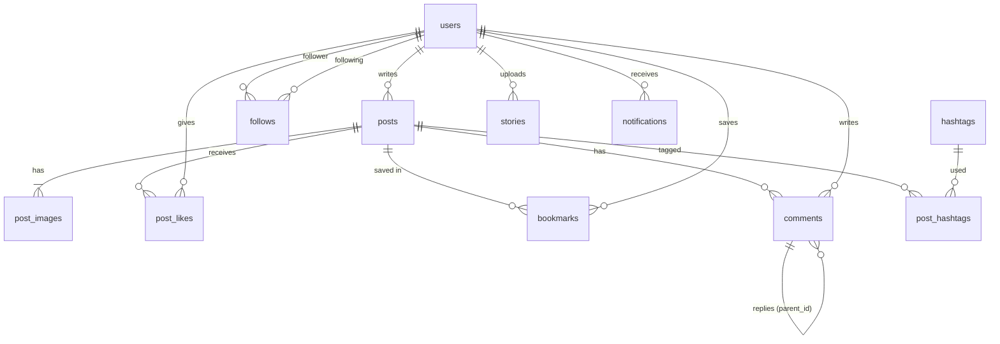

# 데이터베이스 설계 명세서 (db.md)

## 1. 개요
- **DBMS**: SQLite 3 (`backend/instagram.db`)
- **ORM**: SQLAlchemy 2.0 (Declarative `Mapped[]` 스타일) — 모델 위치: `backend/app/models/`
- **스키마 생성**: 서버 시작 시 `Base.metadata.create_all()` 로 자동 생성 (별도 마이그레이션 불필요)
- **필수 PRAGMA** (`app/core/database.py` 의 connect 이벤트에서 매 연결마다 실행):
  - `PRAGMA foreign_keys = ON;` — 외래키 제약 및 `ON DELETE CASCADE` 활성화
  - `PRAGMA journal_mode = WAL;` — 동시 읽기/쓰기 성능 향상
- **시간 저장 규칙**: 모든 `DATETIME` 컬럼은 **naive UTC**로 저장하고, API 응답 시 `...Z` 접미사를 붙인 ISO-8601 문자열로 직렬화

---

## 2. ERD

---

## 3. 테이블 스키마 (11개 테이블)

### 3.1 `users` — 계정 및 프로필
| 컬럼 | 타입 | 제약 | 설명 |
| :--- | :--- | :--- | :--- |
| `id` | INTEGER | PK | |
| `username` | VARCHAR(30) | UNIQUE, INDEX, NOT NULL | 영문 소문자·숫자·`_`·`.` (`^[a-z0-9._]{1,30}$`) |
| `email` | VARCHAR(255) | UNIQUE, INDEX, NOT NULL | 소문자로 정규화하여 저장 |
| `hashed_password` | VARCHAR(255) | NOT NULL | bcrypt 해시 |
| `full_name` | VARCHAR(50) | NOT NULL, 기본 `''` | 성명 |
| `bio` | TEXT | NOT NULL, 기본 `''` | 소개 (API에서 150자 제한, 줄바꿈 허용) |
| `website` | VARCHAR(255) | NOT NULL, 기본 `''` | 스킴 없으면 `https://` 자동 보정 |
| `profile_image_url` | VARCHAR(500) | NULL | `NULL` = 기본 아바타 |
| `is_private` | BOOLEAN | NOT NULL, 기본 `0` | 비공개 계정 |
| `is_active` | BOOLEAN | NOT NULL, 기본 `1` | 비활성 계정은 로그인·조회 불가 |
| `created_at` / `updated_at` | DATETIME | NOT NULL | |

### 3.2 `follows` — 팔로우 관계
| 컬럼 | 타입 | 제약 | 설명 |
| :--- | :--- | :--- | :--- |
| `follower_id` | INTEGER | PK, FK→users CASCADE | 팔로우 하는 사람 |
| `following_id` | INTEGER | PK, FK→users CASCADE | 팔로우 받는 사람 |
| `status` | VARCHAR(10) | CHECK IN (`accepted`,`pending`) | 비공개 계정 대상이면 `pending`(요청) |
| `created_at` | DATETIME | NOT NULL | |
- CHECK `follower_id <> following_id` (자기 자신 팔로우 금지)
- INDEX `ix_follows_following_status (following_id, status)` — 팔로워 수/목록 조회용

### 3.3 `posts` — 게시물
| 컬럼 | 타입 | 제약 |
| :--- | :--- | :--- |
| `id` | INTEGER | PK |
| `user_id` | INTEGER | FK→users CASCADE, INDEX |
| `caption` | TEXT | 최대 2,200자 (API 검증) |
| `location` | VARCHAR(100) | |
| `created_at` | DATETIME | INDEX (피드 정렬) |
| `updated_at` | DATETIME | |

### 3.4 `post_images` — 다중 이미지 (최대 10장)
`id` PK · `post_id` FK→posts CASCADE, INDEX · `image_url` VARCHAR(500) · `display_order` INTEGER (0부터, 캐러셀 순서)

### 3.5 `post_likes` — 좋아요
`(user_id, post_id)` 복합 PK (중복 좋아요 방지) · 둘 다 FK CASCADE · `post_id` INDEX · `created_at`

### 3.6 `bookmarks` — 저장(북마크)
`(user_id, post_id)` 복합 PK · 둘 다 FK CASCADE · `post_id` INDEX · `created_at` (저장됨 탭 정렬 기준)

### 3.7 `comments` — 댓글 / 대댓글
| 컬럼 | 타입 | 제약 | 설명 |
| :--- | :--- | :--- | :--- |
| `id` | INTEGER | PK | |
| `post_id` | INTEGER | FK→posts CASCADE, INDEX | |
| `user_id` | INTEGER | FK→users CASCADE | |
| `parent_id` | INTEGER | FK→comments CASCADE, NULL, INDEX | `NULL` = 최상위 댓글 |
| `content` | TEXT | NOT NULL | |
| `created_at` | DATETIME | | |
- 스레드는 **1단계 깊이**로 유지: 답글의 답글은 최상위 댓글의 `parent_id`로 정규화됨
- 부모 댓글 삭제 시 답글도 CASCADE 삭제

### 3.8 `hashtags` — 해시태그 사전
`id` PK · `name` VARCHAR(100) UNIQUE INDEX (소문자, `#` 제외) · `created_at`

### 3.9 `post_hashtags` — 게시물↔해시태그 N:M
`(post_id, hashtag_id)` 복합 PK · 둘 다 FK CASCADE · `hashtag_id` INDEX
- 캡션 작성/수정 시 정규식 `#([0-9A-Za-z_가-힣]+)` 로 추출하여 재동기화

### 3.10 `stories` — 24시간 스토리
`id` PK · `user_id` FK→users CASCADE · `image_url` · `created_at` · `expires_at` (INDEX, 생성 + 24h)
- INDEX `ix_stories_user_expires (user_id, expires_at)`
- 만료 스토리는 조회에서 제외되며, 서버 시작 시 DB 행과 이미지 파일을 함께 정리

### 3.11 `notifications` — 알림
| 컬럼 | 타입 | 설명 |
| :--- | :--- | :--- |
| `id` | INTEGER PK | |
| `user_id` | FK→users CASCADE | 수신자 |
| `actor_id` | FK→users CASCADE | 행동한 사용자 |
| `type` | VARCHAR(20) CHECK | `like` · `comment` · `reply` · `follow` · `follow_request` |
| `post_id` | FK→posts CASCADE, NULL | |
| `comment_id` | FK→comments CASCADE, NULL | |
| `is_read` | BOOLEAN | |
| `created_at` | DATETIME INDEX | |
- INDEX `ix_notifications_user_read (user_id, is_read)` — 안 읽은 알림 수 폴링용
- 자기 자신에 대한 행동은 알림을 만들지 않음. 좋아요/팔로우 취소 시 해당 알림 삭제
- 팔로우 요청 수락 시 `follow_request` → `follow` 로 타입 변경

---

## 4. 가시성(Visibility) 규칙
게시물/댓글/좋아요/팔로우 목록은 다음 중 하나일 때만 조회 가능합니다.
1. 본인 소유
2. 작성자가 공개 계정(`is_private = 0`)
3. 작성자를 `status = 'accepted'` 로 팔로우 중

비공개 계정을 공개로 전환하면 대기 중인 `pending` 요청은 모두 자동 수락됩니다.

---

## 5. 파일 저장소
DB에는 URL만 저장하고, 실제 이미지는 `backend/static/uploads/` 하위에 저장합니다.

| 폴더 | 용도 | 처리 |
| :--- | :--- | :--- |
| `profiles/` | 프로필 사진 | 320×320 정방형 크롭, JPEG |
| `posts/` | 게시물 이미지 | 긴 변 최대 1440px, JPEG |
| `stories/` | 스토리 | 긴 변 최대 1920px, JPEG |

파일명은 `uuid4().hex + .jpg`. 아바타 교체·게시물 삭제·스토리 삭제 시 기존 파일도 삭제됩니다.
