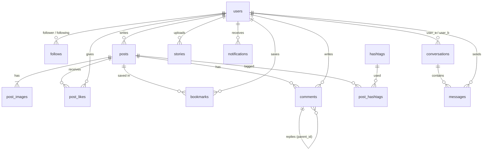

# 데이터베이스 설계 명세서 (db.md)

> 프론트엔드 화면에 존재하는 기능에 필요한 테이블·컬럼만 둡니다. API·운영 기준은 [backend.md](backend.md)를 참고하세요.

## 1. 개요
- **DBMS**: SQLite 3 — 개발·운영(프로덕트) 공통, 단일 파일 `backend/instagram.db`
- **ORM**: SQLAlchemy 2.0 (Declarative `Mapped[]` 스타일) — 모델 위치 `backend/app/models/` (`user.py`, `post.py`, `social.py`, `direct.py`)
- **스키마 생성·변경**
  - 서버 시작 시 `Base.metadata.create_all()`로 없는 테이블 생성
  - 이어서 `app/core/migrations.py`가 기존 테이블을 보정 (현재 스키마를 확인한 뒤 실행하므로 여러 번 실행해도 안전). `seed.py`도 같은 보정을 실행
- **연결마다 실행하는 PRAGMA** (`app/core/database.py`)
  | PRAGMA | 값 | 이유 |
  | :--- | :--- | :--- |
  | `foreign_keys` | `ON` | 외래키 제약과 `ON DELETE CASCADE` 활성화 (SQLite 기본값 OFF) |
  | `journal_mode` | `WAL` | 읽기와 쓰기가 서로 막지 않음 |
  | `busy_timeout` | `5000` | 잠금이 풀릴 때까지 최대 5초 대기 |
  | `synchronous` | `NORMAL` | WAL과 함께 안전하면서 쓰기 속도 향상 |
- **시간**: 모든 `DATETIME`은 naive UTC로 저장, API 응답에서 `...Z`가 붙은 ISO-8601 문자열로 변환
- **불리언**: SQLite `INTEGER` 0/1
- **외래키**: 모두 `ON DELETE CASCADE`

---

## 2. ERD

---

## 3. 테이블 스키마 (13개)

### 3.1 `users` — 계정 및 프로필
| 컬럼 | 타입 | 제약 | 설명 |
| :--- | :--- | :--- | :--- |
| `id` | INTEGER | PK | |
| `username` | VARCHAR(30) | UNIQUE, INDEX, NOT NULL | `^[a-z0-9._]{1,30}$`, 소문자 저장 |
| `email` | VARCHAR(255) | UNIQUE, INDEX, NOT NULL | 소문자로 정규화 |
| `hashed_password` | VARCHAR(255) | NOT NULL | bcrypt 해시 |
| `full_name` | VARCHAR(50) | NOT NULL, 기본 `''` | 성명 |
| `bio` | TEXT | NOT NULL, 기본 `''` | 소개 (API에서 150자 제한, 줄바꿈 허용) |
| `website` | VARCHAR(255) | NOT NULL, 기본 `''` | 스킴 없으면 `https://` 보정 |
| `profile_image_url` | VARCHAR(500) | NULL | `NULL` = 기본 아바타 |
| `is_private` | BOOLEAN | NOT NULL, 기본 0 | 비공개 계정 |
| `created_at` | DATETIME | NOT NULL | 추천 계정 정렬 보조 |

### 3.2 `follows` — 팔로우 관계
| 컬럼 | 타입 | 제약 | 설명 |
| :--- | :--- | :--- | :--- |
| `follower_id` | INTEGER | PK, FK→users | 팔로우 하는 사람 |
| `following_id` | INTEGER | PK, FK→users | 팔로우 받는 사람 |
| `status` | VARCHAR(10) | CHECK IN (`accepted`,`pending`) | 비공개 계정 대상이면 `pending`(요청) |
| `created_at` | DATETIME | NOT NULL | 팔로워/팔로잉 목록 정렬 |
- CHECK `follower_id <> following_id`
- INDEX `ix_follows_following_status (following_id, status)` — 팔로워 수·목록 조회

### 3.3 `posts` — 게시물
| 컬럼 | 타입 | 제약 |
| :--- | :--- | :--- |
| `id` | INTEGER | PK |
| `user_id` | INTEGER | FK→users, INDEX |
| `caption` | TEXT | NOT NULL, 기본 `''` (최대 2,200자, API 검증) |
| `location` | VARCHAR(100) | NOT NULL, 기본 `''` |
| `created_at` | DATETIME | INDEX (피드 정렬) |

### 3.4 `post_images` — 다중 이미지 (1~10장)
`id` PK · `post_id` FK→posts, INDEX · `image_url` VARCHAR(500) · `display_order` INTEGER (0부터, 캐러셀 순서)

### 3.5 `post_likes` — 좋아요
`(user_id, post_id)` 복합 PK (중복 방지) · `post_id` INDEX · `created_at` (좋아요한 사람 목록 정렬)

### 3.6 `bookmarks` — 저장
`(user_id, post_id)` 복합 PK · `post_id` INDEX · `created_at` (저장됨 탭 정렬)

### 3.7 `comments` — 댓글 / 답글
| 컬럼 | 타입 | 제약 | 설명 |
| :--- | :--- | :--- | :--- |
| `id` | INTEGER | PK | |
| `post_id` | INTEGER | FK→posts, INDEX | |
| `user_id` | INTEGER | FK→users | |
| `parent_id` | INTEGER | FK→comments, NULL, INDEX | `NULL` = 최상위 댓글 |
| `content` | TEXT | NOT NULL | |
| `created_at` | DATETIME | | |
- 답글은 **1단계 깊이**만: 답글의 답글은 최상위 댓글의 `parent_id`로 저장
- 부모 댓글 삭제 시 답글도 삭제

### 3.8 `hashtags` — 해시태그 사전
`id` PK · `name` VARCHAR(100) UNIQUE INDEX (소문자, `#` 제외)

### 3.9 `post_hashtags` — 게시물 ↔ 해시태그 (N:M)
`(post_id, hashtag_id)` 복합 PK · `hashtag_id` INDEX
- 캡션 작성·수정 시 정규식 `#([0-9A-Za-z_가-힣]+)`로 추출해 다시 맞춤

### 3.10 `stories` — 24시간 스토리
`id` PK · `user_id` FK→users · `image_url` VARCHAR(500) · `created_at` · `expires_at` (INDEX, 생성 + 24시간)
- INDEX `ix_stories_user_expires (user_id, expires_at)`
- 만료 스토리는 조회에서 제외. 서버 시작 시와 일정 주기(기본 60분)마다 DB 행과 이미지 파일을 함께 삭제

### 3.11 `notifications` — 알림
| 컬럼 | 타입 | 설명 |
| :--- | :--- | :--- |
| `id` | INTEGER PK | |
| `user_id` | FK→users | 수신자 |
| `actor_id` | FK→users | 행동한 사용자 |
| `type` | VARCHAR(20) CHECK | `like` · `comment` · `reply` · `follow` · `follow_request` |
| `post_id` | FK→posts, NULL | |
| `comment_id` | FK→comments, NULL | |
| `is_read` | BOOLEAN, 기본 0 | |
| `created_at` | DATETIME INDEX | |
- INDEX `ix_notifications_user_read (user_id, is_read)` — 안 읽은 알림 수 폴링
- 자기 자신에 대한 행동은 알림을 만들지 않음. 좋아요·팔로우 취소 시 해당 알림 삭제
- 팔로우 요청 수락 시 `follow_request` → `follow`로 변경, 거절 시 삭제

### 3.12 `conversations` — 1:1 대화방
| 컬럼 | 타입 | 제약 | 설명 |
| :--- | :--- | :--- | :--- |
| `id` | INTEGER | PK | |
| `user_a_id` | INTEGER | FK→users | 두 사용자 중 작은 id |
| `user_b_id` | INTEGER | FK→users, INDEX | 큰 id |
| `a_last_read_id` | INTEGER | NOT NULL, 기본 0 | A가 읽은 마지막 메시지 id |
| `b_last_read_id` | INTEGER | NOT NULL, 기본 0 | B가 읽은 마지막 메시지 id |
| `created_at` | DATETIME | NOT NULL | |
| `last_message_at` | DATETIME | NULL, INDEX | 목록 정렬. `NULL`(메시지 없음)이면 목록에서 숨김 |
- CHECK `user_a_id < user_b_id` · UNIQUE `(user_a_id, user_b_id)` — 두 사람 사이 대화방은 1개
- 안 읽은 메시지 = 상대가 보냈고 id가 내 `*_last_read_id`보다 큰 메시지

### 3.13 `messages` — 메시지
`id` PK · `conversation_id` FK→conversations · `sender_id` FK→users · `content` TEXT NOT NULL (≤1000자, API 검증) · `created_at`
- INDEX `ix_messages_conversation_id (conversation_id, id)` — 대화창 페이지네이션·새 메시지 폴링
- 전송 취소 = 행 삭제 후 대화방 `last_message_at` 갱신

---

## 4. 가시성 규칙
게시물·댓글·좋아요 목록·팔로워/팔로잉 목록은 다음 중 하나일 때만 조회할 수 있습니다.
1. 본인 소유
2. 작성자가 공개 계정 (`is_private = 0`)
3. 작성자를 `status = 'accepted'`로 팔로우 중

게스트(비로그인)는 2번만 해당합니다. 비공개 계정을 공개로 전환하면 대기 중인 `pending` 요청은 모두 수락됩니다.

---

## 5. 파일 저장소
DB에는 이미지 URL만 저장하고, 실제 파일은 `backend/static/uploads/` 아래에 저장합니다.

| 폴더 | 용도 | 처리 |
| :--- | :--- | :--- |
| `profiles/` | 프로필 사진 | 320×320 정방형 크롭, JPEG |
| `posts/` | 게시물 이미지 | 긴 변 최대 1440px, JPEG |
| `stories/` | 스토리 | 긴 변 최대 1920px, JPEG |

파일명은 `uuid4().hex + .jpg`. 아바타 교체·게시물 삭제·스토리 삭제·만료 시 파일도 삭제합니다.

---

## 6. 마이그레이션 이력 (`app/core/migrations.py`)
| 날짜 | 내용 |
| :--- | :--- |
| 2026-11-14 | 사용하지 않는 컬럼 삭제: `users.is_active`, `users.updated_at`, `posts.updated_at`, `hashtags.created_at` |

- 마이그레이션은 DB 쓰기 잠금이 필요합니다. 같은 DB를 쓰는 다른 프로세스(이전 서버, 쓰기 모드로 연 DB Browser 등)가 잠금을 잡고 있으면 서버가 시작되지 않습니다.
- 운영 DB는 배포 전에 백업합니다: `sqlite3 instagram.db ".backup 'backup/instagram-YYYYMMDD.db'"`
