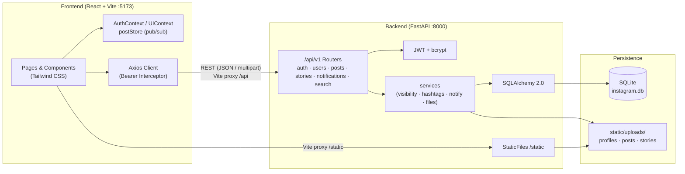

# 전체 프로젝트 개발 가이드 (guide.md)

## 1. 프로젝트 개요
**React + FastAPI + SQLite** 기반의 Instagram 클론 웹 애플리케이션입니다. 회원가입/로그인(JWT), 프로필 관리, 다중 이미지 게시물, 피드, 좋아요·댓글·답글·북마크, 팔로우(비공개 계정 요청 포함), 해시태그·검색·탐색, 24시간 스토리, 알림을 지원합니다.

### 1.1 문서 구성
| 문서 | 내용 |
| :--- | :--- |
| [db.md](db.md) | ERD, 11개 테이블 스키마, 인덱스, 가시성 규칙, 파일 저장 규칙 |
| [backend.md](backend.md) | FastAPI 구조, 공통 규약, 전체 REST API 명세, 보안, 테스트 |
| [front.md](front.md) | React 구조, 라우팅, 화면별 기능, 디자인 시스템/반응형 |
| [guide.md](guide.md) | 아키텍처, 설치·실행 방법, 개발 로드맵, 검증 시나리오 (현재 문서) |

> `backup/` 폴더는 이전 초안(명세서와 일부 코드)을 보관한 것으로, 현재 실행 코드와는 무관합니다.

---

## 2. 시스템 아키텍처



---

## 3. 디렉터리 구조

```text
Instagram_clone/
├── run.bat / run.ps1  # 원클릭 실행 (설치 → 실행 → 브라우저)
├── package.json      # npm start / start:reset / dev / test
├── guide.md · front.md · backend.md · db.md
├── backend/          # FastAPI 서버 (상세: backend.md §2)
│   ├── app/
│   ├── tests/
│   ├── static/uploads/
│   ├── seed.py
│   ├── requirements.txt
│   └── .env(.example)
├── frontend/         # React 웹 앱 (상세: front.md §2)
│   ├── src/
│   ├── public/
│   ├── package.json
│   └── vite.config.js
└── backup/           # 이전 초안 보관
```

---

## 4. 설치 및 실행 (Windows PowerShell 기준)

### 4.0 원클릭 실행 (권장)
사전 준비(Python 3.10+, Node.js)만 되어 있으면 **명령어 하나**로 끝납니다. 별도의 `npm install`/`pip install`은 필요 없습니다.
```powershell
npm run dev        # 프로젝트 루트 또는 frontend 폴더 어디서든 동일하게 동작
```
Node.js가 없을 때는 **`run.bat`을 더블클릭**해도 같은 과정이 실행됩니다(백엔드 자동 재시작 없이).
스크립트(`run.ps1`)가 자동으로 처리하는 일:
1. Python 3.10+ / Node.js 확인 (새로 설치한 프로그램도 인식하도록 PATH 다시 읽기)
2. 포트 8000·5173 사용 여부 확인
3. `backend/venv` 생성 + `pip install` (requirements.txt가 바뀐 경우에만)
4. `backend/.env` 생성 (랜덤 `SECRET_KEY`), 첫 실행 시 데모 데이터 생성
5. `npm install` (package-lock.json이 바뀐 경우에만)
6. 백엔드 → 프론트엔드 순서로 실행, 준비되면 브라우저에서 `http://localhost:5173` 열기
7. **Ctrl+C**로 두 서버를 함께 종료 (한쪽이 죽으면 다른 쪽도 정리)

| 옵션 | 설명 | npm 스크립트 |
| :--- | :--- | :--- |
| `-Reload` | 백엔드 코드(`backend/app`) 변경 시 자동 재시작. 프론트엔드는 항상 즉시 반영(HMR) | **`npm run dev`** |
| (없음) | 자동 재시작 없이 실행 | `npm start` |
| `-Reset` | DB·업로드 초기화 후 데모 데이터 재생성 | `npm run reset` |
| `-NoBrowser` | 브라우저 자동 열기 끄기 | |
| `-SkipInstall` | 패키지 확인 건너뛰기 (빠른 재시작) | |

예: `.\run.bat -Reset -NoBrowser`. 백엔드 테스트는 `npm test`.

아래 4.1~4.3은 각 단계를 수동으로 실행하는 방법입니다.

### 4.1 사전 준비
- **Python** 3.10 이상
- **Node.js** 18 / 20 / 22 LTS (`npm` 포함) — 설치: `winget install OpenJS.NodeJS.LTS` 또는 https://nodejs.org
- (선택) Git

### 4.2 백엔드
```powershell
cd backend
python -m venv venv
.\venv\Scripts\Activate.ps1          # 실행 정책 오류 시: Set-ExecutionPolicy -Scope CurrentUser RemoteSigned
pip install -r requirements.txt
copy .env.example .env               # 이후 SECRET_KEY를 긴 랜덤 문자열로 변경
python seed.py                       # (선택) 데모 데이터 — 로그인: demo / password123
uvicorn app.main:app --reload --port 8000
```
- API: `http://localhost:8000` · Swagger: `http://localhost:8000/docs` (우측 상단 **Authorize** 로 로그인 가능)
- 데모 데이터 초기화: `python seed.py --reset` (DB와 업로드 파일 삭제 후 재생성)
- 테스트: `python -m pytest -q`

`.env` 항목

| 키 | 기본값 | 설명 |
| :--- | :--- | :--- |
| `DATABASE_URL` | `sqlite:///./instagram.db` | `./` 상대 경로는 `backend/` 기준 |
| `SECRET_KEY` | — | JWT 서명 키 (32바이트 이상) |
| `ALGORITHM` | `HS256` | |
| `ACCESS_TOKEN_EXPIRE_MINUTES` | `1440` | |
| `UPLOAD_DIR` | `./static/uploads` | |
| `CORS_ORIGINS` | `["http://localhost:5173","http://127.0.0.1:5173"]` | JSON 배열 |

### 4.3 프론트엔드
```powershell
cd frontend
npm install
npm run dev:vite                     # 프론트엔드만 실행 http://localhost:5173 (npm run dev 는 전체 실행)
npm run build                        # 프로덕션 빌드 → dist/
```
Vite 개발 서버가 `/api`, `/static` 요청을 `http://127.0.0.1:8000` 으로 프록시하므로 **백엔드를 먼저 실행**해야 합니다.

---

## 5. 개발 로드맵 (구현 현황)

### Phase 1 — 기반 + 인증 + 프로필 ✅
- SQLite 연결(`foreign_keys=ON`, WAL), `users`·`follows`, bcrypt, JWT
- `POST /auth/register` · `POST /auth/login` · `GET /auth/me`
- `GET /users/{username}` · `PUT /users/me/profile` · `POST/DELETE /users/me/avatar` · `PUT /users/me/password`
- `AuthContext`, `ProtectedRoute`/`GuestRoute`, 로그인·회원가입·프로필·프로필 편집·아바타 모달

### Phase 2 — 게시물 & 피드 ✅
- `posts`·`post_images`·`hashtags`·`post_hashtags`
- 다중 이미지 업로드(`POST /posts`), `ImageCarousel`, 피드(`GET /posts/feed`) 무한 스크롤, 프로필 3열 그리드, 게시물 수정/삭제

### Phase 3 — 소셜 인터랙션 ✅
- `post_likes`·`bookmarks`·`comments` 토글 API, 더블클릭 좋아요, 댓글/답글 작성·삭제, `PostDetailModal`
- 팔로우 토글, 비공개 계정 팔로우 요청/수락/거절, 팔로워/팔로잉/좋아요 목록 모달, 저장됨 탭

### Phase 4 — 검색 · 탐색 · 스토리 · 알림 ✅
- 통합 검색(`SearchDrawer`, 최근 검색), 탐색(`/explore`), 해시태그 페이지
- 24시간 스토리(업로드·뷰어·삭제·본 표시), 알림(폴링 배지, 읽음 처리)
- 스켈레톤 로딩, 반응형(모바일 하단 탭바), 토스트·에러 처리

### 향후 확장 아이디어
DM(WebSocket), 릴스(동영상), 댓글 좋아요, 게시물 내 사용자 태그, 커서 기반 페이지네이션, 이미지 CDN/S3, Alembic 마이그레이션, 다크 모드

---

## 6. 통합 검증 시나리오 (Checklist)

1. **회원가입 & 중복 검증** — `/register`에서 가입 → JWT 발급 후 `/` 이동. 같은 username/email 재가입 시 `409` 메시지 표시.
2. **로그인 & 세션 유지** — 로그아웃 → `/login`에서 아이디 또는 이메일로 로그인 → `F5` 후에도 로그인 유지(`GET /auth/me`). 틀린 비밀번호는 빨간 에러.
3. **프로필 사진** — 프로필 아바타 클릭 또는 `/accounts/edit`에서 업로드 → 헤더·사이드바 즉시 변경. `[현재 사진 삭제]` → 기본 아바타.
4. **프로필 정보** — 이름, 여러 줄 소개, 웹사이트 수정 후 저장 → `/:username`에 반영. 150자 카운터 확인.
5. **게시물** — 이미지 2장 이상 + `#해시태그` 캡션 업로드 → 피드 맨 위에 표시, 캐러셀 넘기기, 더블클릭 좋아요, 댓글/답글, 북마크 → `저장됨` 탭 확인.
6. **팔로우 & 비공개** — 다른 계정으로 비공개 전환 → 팔로우 시 `요청됨` → 알림에서 `확인` → 게시물 열람 가능.
7. **검색/탐색** — 사이드바 검색에서 사용자/`#태그` 검색, 해시태그 페이지 이동, 탐색 그리드 무한 스크롤.
8. **스토리 & 알림** — 스토리 업로드/재생/삭제, 다른 계정의 좋아요·댓글 후 알림 배지 증가 확인.
9. **반응형** — 브라우저 폭 1280 / 900 / 375px에서 사이드바 → 아이콘 사이드바 → 하단 탭바 전환 확인.
